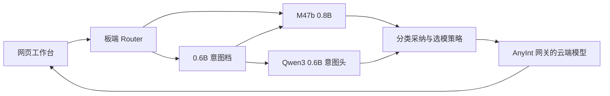

# AnyInt Lite Router · 此芯 P1 智能路由

在此芯 P1 上完成请求分类和选模，再通过 AnyInt 网关调用一个云端模型。网页展示请求特征、各分类信号及概率、路由判定、实际云端调用和最终回答。

| 网页档位 | 板端推理 |
| --- | --- |
| 0.8B | M47b 判断领域、意图和工具需求 |
| 0.6B | Qwen3-Embedding-0.6B LoRA 判断意图，M47b 0.8B 判断领域和工具需求 |

## 一键查看

需要 Git、Bash、Python 3.10+ 和浏览器。Windows 可在 WSL 中运行。

```bash
git clone https://github.com/newer-er/cix-p1-lite-router.git
cd cix-p1-lite-router
./deploy.sh
```

打开 [http://127.0.0.1:18812/](http://127.0.0.1:18812/)。右上角会显示「离线回放」，可切换两档并发送「巡检交接」和「脚本修复」示例。回放用固定的合成数据演示界面与轨迹。

## 一键部署到此芯 P1

实机环境使用此芯 P1 香橙派、ARM64 Linux 和 Python 3.12。Debian 或 Ubuntu 需要系统包 `python3.12-venv` 和 `libgomp1`。首次安装需要访问 PyPI、PyTorch CPU wheel 索引和 AnyInt 网关。两套模型以 CPU FP32 运行，准备至少 8 GiB 可用内存及足够的模型和依赖磁盘空间。

脚本会创建 `.venv-board`，安装 PyTorch 2.8.0 CPU 和固定版本的主要板端依赖，依次启动两套分类服务、两路 Router 和网页。已有兼容环境可用 `--python /path/to/venv/bin/python`。
[板端 Python 依赖](board/requirements.txt) · [PyTorch CPU 索引](https://download.pytorch.org/whl/cpu/torch/)

### 模型资产

实机模式从本地磁盘读取参赛模型资产。把模型包放在下列目录，或在部署命令中传入各自路径。训练权重随实机复现资产单独提供。

```text
assets/
├── m47b/
│   ├── manifest.json
│   ├── config.json
│   ├── model.safetensors
│   └── tokenizer/
│       ├── tokenizer.json
│       └── tokenizer_config.json
└── intent06b/
    ├── models/embedding_intent_06b_final_20261116/
    │   ├── best_trainable.safetensors
    │   ├── model_spec.json
    │   └── training_policy.json
    └── backbone/Qwen3-Embedding-0.6B/
        ├── config.json
        ├── model.safetensors
        ├── tokenizer.json
        ├── tokenizer_config.json
        ├── merges.txt
        └── vocab.json
```

| 资产 | 参赛版本 |
| --- | --- |
| M47b 导出包 | `m47b_qwen_lora_8ep_20261023:444d338b32fe`，已合并 LoRA |
| 0.6B 意图 checkpoint | `intent06b_20261116:9cb0dc716320`，双视图第 4 轮 |
| 0.6B 公开基座 | Qwen3-Embedding-0.6B revision `97b0c614be4d77ee51c0cef4e5f07c00f9eb65b3` |

分类服务在启动时校验权重、配置和词表。0.6B 双视图的提示格式、池化和标签顺序来自训练归档。保留公开基座随附的许可证。 [Qwen3-Embedding-0.6B 模型卡](https://huggingface.co/Qwen/Qwen3-Embedding-0.6B)

### 运行

在开发板克隆仓库后，从仓库根目录执行下面的命令。第一行在终端读取自己的 AnyInt API Key。

```bash
read -r -s -p "AnyInt API Key: " ANYINT_API_KEY
printf '\n'
export ANYINT_API_KEY
./deploy.sh board --m47b-bundle ./assets/m47b --intent-assets ./assets/intent06b
```

默认上游为 `https://api.anyint.ai/openai/v1`，可通过 `ANYINT_BASE_URL` 指定兼容接口。网页和板端服务都监听回环地址。用板上浏览器打开网页，或在录屏电脑做端口转发。

```bash
ssh -N -L 18812:127.0.0.1:18812 user@board-address
```

网页默认端口是 `18812`，分类服务用 `18910`、`18911`，Router 用 `18912`、`18913`。可用 `--port` 和 `--first-service-port` 调整。按 Ctrl+C 停止整套服务。接入已启动的 Router 时，可直接运行 `python3 server.py --router-url <0.8B地址> --intent-router-url <0.6B地址>`，两个地址均为 API 根地址。

## 请求链路与验收



1. 使用「巡检交接」查看通用任务、分类结果和实际调用的模型。
2. 使用「脚本修复」查看规则初判、分类采纳和云端回答。点开任一信号即可查看概率。
3. 切换 0.8B 和 0.6B，用同一请求分别发送。0.6B 档的信号卡片会标出各信号的模型来源，可展开「对比最近两次」核对结果。

实机模式从 `x1_route` 读取分类版本、采纳项、选中的 Worker 和板内耗时。领域置信度阈值为 0.7，低于阈值时回退到规则，页面会显示回退原因。实机模式对一条请求发出一次云端生成，输出上限为 640 token。云端模型取决于请求类型和当前网关目录。

## 代码入口

| 路径 | 用途 |
| --- | --- |
| `index.html`、`app.js`、`styles.css`、`hero.js` | 演示页、模型切换、路由轨迹和首页动效 |
| `server.py`、`replay.py` | 网页服务、板端转发和合成示例 |
| `board/fusion/` | 此芯 P1 部署版本的分类器、信号协议和选模策略 |
| `board/edge_router.py`、`board/intent_classifier.py` | 演示 Router 和 0.6B 意图合并服务 |
| `deploy.sh`、`board/launch.py` | 入口脚本、环境安装、进程编排 |

界面参考 System Duo 的路由展示，配色和标志沿用 AnyInt 网关。 [System Duo](https://app.vllm-sr.ai/) · [AnyInt](https://anyint.ai/)
